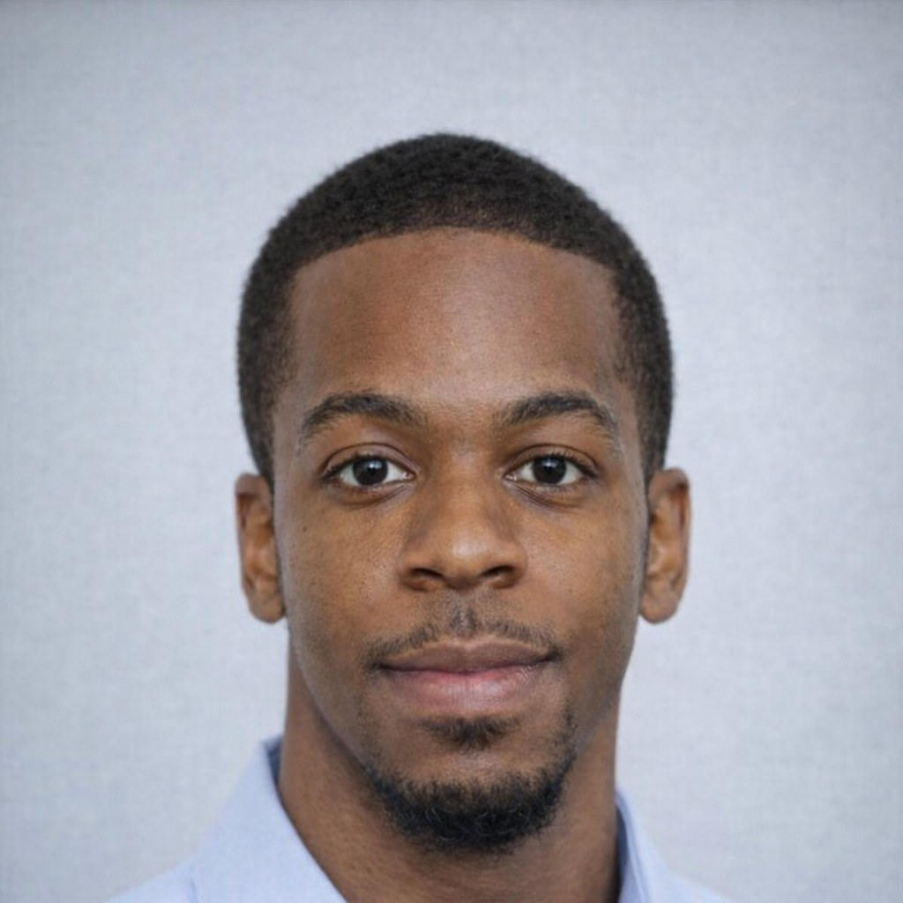

# Denzell Richardson

Computer Science student at Borough of Manhattan Community College, expected graduation Fall 2027. Based in Brooklyn. I build small Python and TypeScript projects, test them, and write down the limits of the result.

Open to junior roles in machine learning, quant research, data or Python engineering, and IT support.

[Portfolio](https://staticshock1013.github.io/Portfolio/) · [LinkedIn](https://www.linkedin.com/in/denzell-richardson-9877b43a8) · [Email](mailto:Denzellr96@gmail.com)

 

## Start here

These are the repositories worth opening. The rest of the account is coursework and early practice.

| Project | What it shows |
| --- | --- |
| [engineering-showcase](https://github.com/Staticshock1013/engineering-showcase) | Two shipped pieces: **quant-lab**, a research-only NQ futures backtester with pre-registered specs and tests, and **TerraTrend Global**, a Streamlit view of NASA MODIS samples. |
| [algo-trading](https://github.com/Staticshock1013/algo-trading) | A research log. Price models did not beat a naive baseline. An intraday NQ mean-reversion idea did not hold on earlier years. |
| [coffee-route-tracker](https://github.com/Staticshock1013/coffee-route-tracker) | A TypeScript dashboard for a coffee-machine route. Fictional sample data, Vitest on the revenue math, GitHub Actions for build and test. |
| [Portfolio](https://github.com/Staticshock1013/Portfolio) | The site linked above: short bio, project list, and resume. |

## What I use

Python, pandas, pytest, JavaScript and TypeScript, React, HTML/CSS, Git, and GitHub Actions. Google IT Support and CompTIA IT Fundamentals are in progress, not finished.

## Coursework on this account

`odin-recipes`, `css-exercises`, `Landing-page`, `javascript-exercises`, `Rock-Paper-Scissors`, `etch-a-sketch`, `Calculator`, `JavaScript30`, and `git_test` are practice from The Odin Project, JavaScript30, and early Git. They are not the work I want reviewed first.

Daily commits will keep landing in the showcase and the research log as those projects grow.
